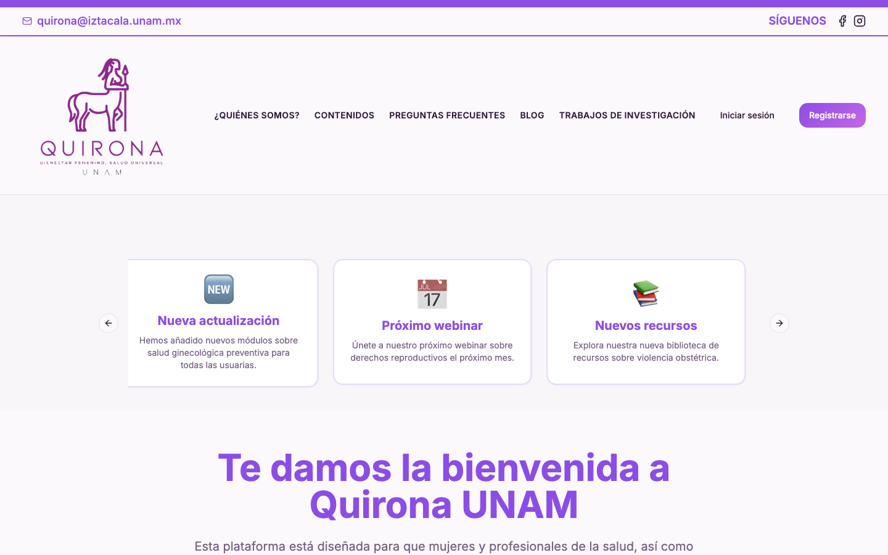
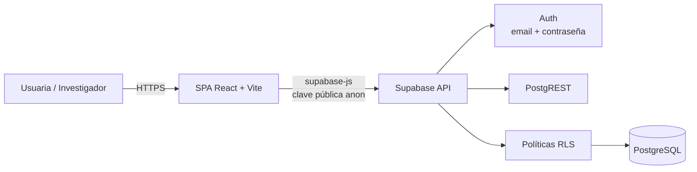

<div align="center">

# 🌸 Quirona Empower Her

**Plataforma educativa digital sobre salud ginecológica, prevención de violencia ginecológica y derechos en salud para mujeres adolescentes.**

[](https://react.dev)
[](https://www.typescriptlang.org)
[](https://vitejs.dev)
[](https://tailwindcss.com)
[](https://supabase.com)
[](./LICENSE)

Proyecto académico de la **FES Iztacala, UNAM**, con la colaboración de **SUAyED**, **IPN** y **ESCOM**.

</div>

<div align="center">
  
</div>

---

## 📖 Descripción

Quirona es una aplicación web que acompaña a mujeres adolescentes en un recorrido formativo de cuatro módulos sobre salud ginecológica y prevención de la violencia ginecológica y obstétrica. Combina contenidos narrativos, cuestionarios, actividades interactivas y una batería de instrumentos psicométricos de evaluación inicial y final, con un panel de seguimiento para el equipo de investigación.

El sistema contempla dos tipos de acceso:

- **Usuarias**: recorren módulos, responden tests y consultan su progreso.
- **Investigadoras/es**: dan seguimiento al avance y a los resultados del estudio.

> ⚠️ Este repositorio contiene código de una plataforma que trata **datos personales sensibles de salud**. El código se distribuye bajo GPL-3.0; el despliegue con datos reales y el uso de los instrumentos requiere autorización del equipo responsable.

---

## 📑 Tabla de contenidos

- [Características](#-características)
- [Stack tecnológico](#-stack-tecnológico)
- [Arquitectura](#-arquitectura)
- [Estructura del proyecto](#-estructura-del-proyecto)
- [Requisitos](#-requisitos)
- [Puesta en marcha](#-puesta-en-marcha)
- [Variables de entorno](#-variables-de-entorno)
- [Scripts disponibles](#-scripts-disponibles)
- [Rutas de la aplicación](#-rutas-de-la-aplicación)
- [Modelo de datos](#-modelo-de-datos)
- [Roles y control de acceso](#-roles-y-control-de-acceso)
- [Flujo de la usuaria](#-flujo-de-la-usuaria)
- [Seguridad y privacidad](#-seguridad-y-privacidad)
- [Pruebas](#-pruebas)
- [Despliegue](#-despliegue)
- [Solución de problemas](#-solución-de-problemas)
- [Estado del proyecto](#-estado-del-proyecto)
- [Contribución](#-contribución)
- [Licencia](#-licencia)
- [Créditos](#-créditos)
- [Contacto](#-contacto)

---

## ✨ Características

| Área | Detalle |
|---|---|
| **Contenido educativo** | 4 módulos con relato, introducción, quiz, visita guiada, actividad interactiva, retroalimentación y cierre |
| **Evaluación** | Test inicial, red semántica, inventario de ansiedad, escala de asertividad, experiencias adversas, salud general y 3 evaluaciones finales |
| **Progreso** | Seguimiento por módulo y porcentaje global, con desbloqueo secuencial |
| **Buzón** | Envío de sugerencias de las usuarias al equipo de investigación |
| **Panel de investigación** | Métricas de participación, avance por módulo y resultados agregados |
| **Derivación y apoyo** | Directorio de líneas de ayuda y servicios de atención con marcado directo |
| **Accesibilidad y UX** | Diseño responsivo, componentes accesibles (Radix UI), navegación por sesiones |
| **Consentimiento informado** | Asentimiento, aviso de privacidad y selección de programa durante el registro |

---

## 🧰 Stack tecnológico

| Capa | Tecnología |
|---|---|
| **UI** | React 18, TypeScript 5, Tailwind CSS 3, shadcn/ui + Radix UI, lucide-react |
| **Build** | Vite 5 (`@vitejs/plugin-react-swc`) |
| **Ruteo** | React Router DOM 6 |
| **Estado y datos** | TanStack Query 5, React Hooks |
| **Formularios** | React Hook Form + Zod |
| **Backend** | Supabase (PostgreSQL, Auth, Row Level Security) |
| **Gráficas** | Recharts |
| **Hosting sugerido** | Netlify (incluye `dist/_redirects` para SPA) |

---

## 🏗️ Arquitectura



- El cliente es una **SPA** que se sirve como archivos estáticos.
- Toda la persistencia y autenticación pasa por **Supabase** mediante `@supabase/supabase-js`.
- El control de acceso a los datos se define en **políticas RLS** del lado de la base de datos; el cliente **solo** utiliza la clave pública (`anon` / `publishable`).
- No existe backend propio: cualquier lógica privilegiada debe implementarse en Supabase (funciones `SECURITY DEFINER` o Edge Functions), nunca en el navegador.

---

## 📂 Estructura del proyecto

```text
quirona/
├── docs/                    # Capturas y documentación del proyecto
├── public/                  # Archivos estáticos y _redirects (SPA)
├── supabase/                # Migraciones SQL y verificaciones de seguridad
├── src/
│   ├── assets/              # Imágenes, logos y video de bienvenida
│   ├── components/          # Componentes de aplicación
│   │   └── ui/              # Biblioteca shadcn/ui (49 componentes)
│   ├── hooks/               # Hooks personalizados (rol, mobile, toast)
│   ├── layouts/             # UserLayout, ResearcherLayout
│   ├── lib/                 # Utilidades, progreso y helpers
│   ├── pages/               # 56 vistas (módulos, tests, paneles)
│   ├── test/                # Setup de Vitest / Testing Library
│   ├── App.tsx              # Definición de rutas
│   ├── main.tsx             # Punto de entrada
│   └── supabaseClient.js    # Cliente de Supabase
├── .env.example             # Plantilla de variables de entorno
├── ROADMAP.md               # Plan de trabajo y pendientes
├── tailwind.config.ts
├── vitest.config.ts         # Configuración de pruebas
└── vite.config.ts
└── vite.config.ts
```

---

## ✅ Requisitos

| Herramienta | Versión recomendada |
|---|---|
| Node.js | 20 LTS o superior (mínimo 18) |
| npm | 9 o superior |
| Cuenta/proyecto de Supabase | Con las tablas y políticas del proyecto |
| Git | 2.30 o superior |

---

## 🚀 Puesta en marcha

```bash
# 1. Clonar el repositorio
git clone https://github.com/jctovar/Quirona.git
cd Quirona

# 2. Instalar dependencias
npm install

# 3. Configurar variables de entorno
cp .env.example .env
# edita .env con los datos de tu proyecto de Supabase

# 4. Levantar el entorno de desarrollo
npm run dev
```

La aplicación queda disponible en **http://localhost:8080**.

> Si el puerto está ocupado, Vite elegirá el siguiente libre e imprimirá la URL en la terminal.

---

## 🔐 Variables de entorno

Crea un archivo `.env` en la raíz (está incluido en `.gitignore`):

| Variable | Descripción | Ejemplo |
|---|---|---|
| `VITE_SUPABASE_URL` | URL del proyecto de Supabase | `https://<project-ref>.supabase.co` |
| `VITE_SUPABASE_ANON_KEY` | Clave pública `anon` o `publishable` | `eyJhbGciOi...` o `sb_publishable_...` |

**Reglas de seguridad:**

- ✅ Usa únicamente la clave **pública** (`anon` / `publishable`).
- ❌ Nunca coloques `service_role` ni `sb_secret_...`: **todo lo que empieza con `VITE_` se incluye en el bundle del navegador**.
- ❌ No subas `.env` al repositorio.

En el hosting, configura las mismas variables en el panel del proveedor (Netlify/Vercel) antes de compilar.

---

## 📜 Scripts disponibles

| Comando | Descripción |
|---|---|
| `npm run dev` | Servidor de desarrollo con HMR en el puerto 8080 |
| `npm run build` | Build de producción en `dist/` |
| `npm run build:dev` | Build en modo desarrollo |
| `npm run preview` | Sirve localmente el build de producción |
| `npm run lint` | Ejecuta ESLint sobre todo el proyecto |
| `npm test` | Ejecuta la suite de pruebas unitarias (Vitest) |
| `npm run test:watch` | Pruebas en modo interactivo |
| `npm run test:coverage` | Pruebas con reporte de cobertura |

---

## 🗺️ Rutas de la aplicación

### Públicas

| Ruta | Vista |
|---|---|
| `/` | Inicio |
| `/quienes-somos` | Quiénes somos |
| `/contenidos` | Contenidos |
| `/preguntas` | Preguntas frecuentes |
| `/trabajos` | Trabajos de investigación |
| `/login` · `/register` | Acceso y registro |

### Área de la usuaria

| Ruta | Vista |
|---|---|
| `/initial-question` · `/pre-education` | Pregunta inicial y preparación |
| `/dashboard` · `/profile` | Panel y perfil |
| `/initial-test` · `/semantic-network-test` · `/anxiety-inventory` | Evaluaciones iniciales |
| `/assertiveness-scale` · `/adverse-experiences` · `/general-health` | Instrumentos psicométricos |
| `/derivacion` · `/apoyo` | Directorio de ayuda |
| `/module-1` … `/module-4-*` | Contenido de los 4 módulos |
| `/final-test-1` · `/final-test-2` · `/final-test-3` | Evaluaciones finales |

### Área de investigación

| Ruta | Vista |
|---|---|
| `/researcher-dashboard` | Panel de seguimiento del estudio |
| `/researcher/perfilInvestigador` | Perfil del investigador |
| `/researcher/profileInvestigador` | Configuración del perfil |

---

## 🗃️ Modelo de datos

Tablas principales en Supabase (esquema `public`):

| Tabla | Contenido |
|---|---|
| `profiles` | Datos de la participante y rol (`user` / `researcher`) |
| `user_progress` | Avance por módulo y porcentaje global |
| `module_1_responses` … `module_4_responses` | Respuestas y puntajes de cada módulo |
| `initial_test_responses` | Test inicial |
| `semantic_network_responses` | Red semántica |
| `anxiety_inventory_responses` | Inventario de ansiedad (estado/rasgo, inicial y final) |
| `assertiveness_scale_responses` | Escala de asertividad |
| `adverse_experiences_responses` | Experiencias adversas |
| `general_health_responses` | Salud general |
| `final_evaluations` | Evaluaciones finales 1, 2 y 3 |
| `suggestions` | Buzón de sugerencias |
| `admin_feedback` | Retroalimentación del equipo |
| `test_attempts`, `test_sus_responses`, `test_usability_responses`, `apoi_test` | Instrumentos complementarios de usabilidad y aceptación |

Funciones RPC de apoyo para validación de rol y tareas administrativas del equipo de investigación.

---

## 👥 Roles y control de acceso

| Rol | Acceso |
|---|---|
| `user` | Módulos, evaluaciones, progreso propio, sugerencias y perfil propio |
| `researcher` | Panel de investigación, seguimiento de participantes y resultados agregados |
| `admin` | Lectura global de perfiles y tareas de administración (se asigna solo por SQL o `service_role`) |

- El rol se almacena en `profiles.role`.
- La interfaz redirige según el rol al iniciar sesión.
- **La autorización real debe vivir en RLS y en funciones del servidor**; las comprobaciones del cliente son solo de experiencia de usuario.

---

## 🩺 Flujo de la usuaria

```text
Registro + asentimiento informado
        ↓
Pregunta inicial → Preparación
        ↓
Evaluaciones iniciales (6 instrumentos)
        ↓
Módulo 1 → Módulo 2 → Módulo 3 → Módulo 4
  (relato · intro · quiz · visita · actividad · feedback · cierre)
        ↓
Evaluaciones finales (3)
        ↓
Panel de progreso · Derivación y apoyo · Buzón de sugerencias
```

---

## 🔒 Seguridad y privacidad

Este proyecto maneja datos de salud mental y experiencias de violencia, considerados **datos personales sensibles**.

- El repositorio **no** contiene credenciales: `.env` está ignorado y solo se versiona `.env.example`.
- El cliente usa exclusivamente la clave pública; las claves privadas se gestionan fuera del frontend.
- El acceso a datos se restringe con **Row Level Security** en PostgreSQL.
- Los parches de RLS, permisos y RPC viven en [`supabase/migrations/`](./supabase/migrations/) con instrucciones en [`supabase/README.md`](./supabase/README.md).
- El registro incluye asentimiento informado y aviso de privacidad.
- Recomendaciones para contribuir:
  - No registrar datos personales en `console.log`.
  - No incluir datos reales en issues, capturas o pruebas.
  - No desactivar RLS para “probar rápido”.

Si encuentras una vulnerabilidad, **no abras un issue público**: repórtala al correo de contacto.

---

## 🧪 Pruebas

La suite usa **Vitest** + **Testing Library** sobre `jsdom`:

| Comando | Descripción |
|---|---|
| `npm test` | Ejecuta todas las pruebas una vez |
| `npm run test:watch` | Reejecuta al guardar cambios |
| `npm run test:coverage` | Genera el reporte en `coverage/` |

**36 pruebas en 7 archivos:**

| Área | Archivo | Qué cubre |
|---|---|---|
| Progreso local | `src/lib/testProgress.ts` | Persistencia en `localStorage`, JSON corrupto y acumulación de tests |
| Progreso en BD | `src/lib/progressHelper.ts` | Guardado según rol (mock de Supabase), errores y sesión ausente |
| Utilidades | `src/lib/utils.ts` | Merge de clases y conflictos de Tailwind |
| Ruteo por rol | `src/hooks/useRoleNavigation.ts` | Rutas de usuaria vs. investigador |
| Responsive | `src/hooks/use-mobile.tsx` | Breakpoint, cambio de tamaño y limpieza del listener |
| Componente | `src/components/ModuleCard.tsx` | Contenido, autoría y callback |
| Componente | `src/components/TestMenu.tsx` | Estados de progreso, bloqueo de módulos y navegación |

Configuración: `vitest.config.ts` y `src/test/setup.ts`. El setup incluye un `localStorage` en memoria por una incompatibilidad entre Node 26 y jsdom.

---

## 🌐 Despliegue

El proyecto se despliega como sitio estático:

```bash
npm run build     # genera dist/
```

| Proveedor | Configuración |
|---|---|
| **Netlify** | Build: `npm run build` · Publish: `dist` · Variables `VITE_SUPABASE_*` en el panel. `dist/_redirects` ya resuelve el fallback SPA |
| **Vercel** | Build: `npm run build` · Output: `dist` · Añadir rewrite a `index.html` |
| **Nginx/Apache** | Servir `dist/` con fallback a `index.html` para rutas del cliente |

---

## 🧯 Solución de problemas

| Síntoma | Causa probable | Solución |
|---|---|---|
| Pantalla en blanco al arrancar | Falta `.env` o variables vacías | Crear `.env` desde `.env.example` y reiniciar Vite |
| `supabaseUrl is required` | `VITE_SUPABASE_URL` no definida | Verificar el `.env` y reiniciar el servidor |
| El puerto 8080 está ocupado | Otra instancia de Vite | Cerrar la anterior o usar la URL que imprime Vite |
| Error 404 al recargar una ruta | Falta fallback SPA en el hosting | Configurar `_redirects` o rewrite a `index.html` |
| Fallo de instalación | Caché o versiones incompatibles | `rm -rf node_modules package-lock.json && npm install` |

---

## 📌 Estado del proyecto

| Comprobación | Estado |
|---|---|
| Build de producción (`npm run build`) | ✅ |
| Verificación de tipos (`tsc --noEmit`) | ✅ |
| Lint (`npm run lint`) | ⚠️ 24 errores y 7 advertencias conocidas |
| Pruebas unitarias (`npm test`) | ✅ 36 pruebas |
| Pruebas de integración/E2E y CI | ⏳ Pendiente |
| Revisión de seguridad de RLS y políticas de acceso | 🔄 En curso |

El plan detallado de pendientes está en [`ROADMAP.md`](./ROADMAP.md).

---

## 🤝 Contribución

1. Crea una rama descriptiva:
   ```bash
   git checkout -b fix/rls-perfiles
   ```
2. Sigue **Conventional Commits** con emoji:
   ```text
   ✨ feat: agregar validación de CURP
   🐛 fix: corregir cálculo de progreso del módulo 3
   📝 docs: actualizar guía de despliegue
   ```
3. Antes de abrir un PR:
   ```bash
   npm run lint
   npm run build
   ```
4. Abre el PR contra `main` de tu fork y describe el cambio y su impacto.

**Convención de ramas:** `feat/…`, `fix/…`, `docs/…`, `chore/…`, `refactor/…`.

Consulta [`CONTRIBUTING.md`](./CONTRIBUTING.md) para el flujo completo, los estándares de código y las reglas de seguridad y privacidad.

---

## 📄 Licencia

Este proyecto se distribuye bajo la **GNU General Public License v3.0**. El texto completo está en [`LICENSE`](./LICENSE).

```text
Copyright (C) 2025 Proyecto Quirona — FES Iztacala, UNAM
```

Implicaciones principales:

- Puedes usar, estudiar, modificar y redistribuir el código.
- Cualquier trabajo derivado debe distribuirse bajo **GPL-3.0** y conservar los avisos de copyright.
- El software se entrega **sin garantía**, según los términos de la licencia.
- La licencia cubre el **código**. Los contenidos educativos, instrumentos psicométricos, imágenes y datos del estudio **no** se licencian automáticamente y su uso requiere autorización del equipo responsable.

---

## 🏅 Créditos

**Contenido de módulos**

| Módulo | Autor/a |
|---|---|
| 1. Ginecología preventiva | Javier Darío Ríos Castillo |
| 2. Estándares de atención en consulta ginecológica | Aline González Castro |
| 3. ¿Qué es la violencia ginecológica? | Javier Darío Ríos Castillo |
| 4. Responder a la violencia ginecológica | Alfonso Mendoza |

**Instituciones colaboradoras:** UNAM · FES Iztacala · SUAyED · IPN · ESCOM

**Líneas de apoyo incluidas:** Línea UNAM, Línea de la Vida, Línea de las Mujeres, Locatel, Línea sin Violencia del Estado de México, Centros de Integración Juvenil, SALME y Línea de Consejo Ciudadano.

---

## 📬 Contacto

- **Correo:** quirona@iztacala.unam.mx
- **Dirección:** Av. de los Barrios No. 1, Los Reyes Iztacala, Tlalnepantla de Baz, Estado de México, C.P. 54090
- **Repositorio original:** [leyvaortiznazli/Quirona](https://github.com/leyvaortiznazli/Quirona)

---

<div align="center">

**Proyecto académico e institucional de la UNAM.**
Código bajo GPL-3.0 · Contenidos, instrumentos y datos requieren autorización del equipo responsable.

© 2025 QUIRONA UNAM · Educación en salud ginecológica

</div>
